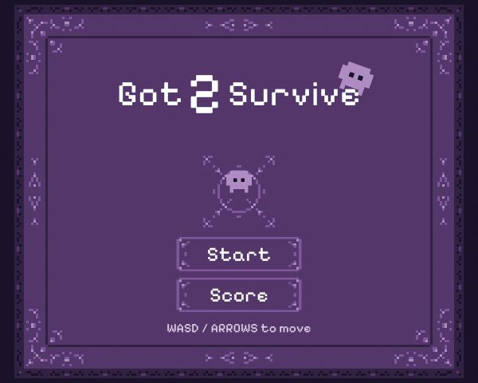
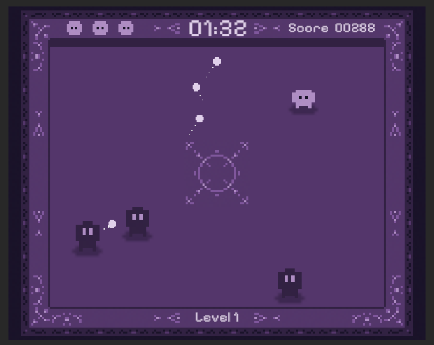
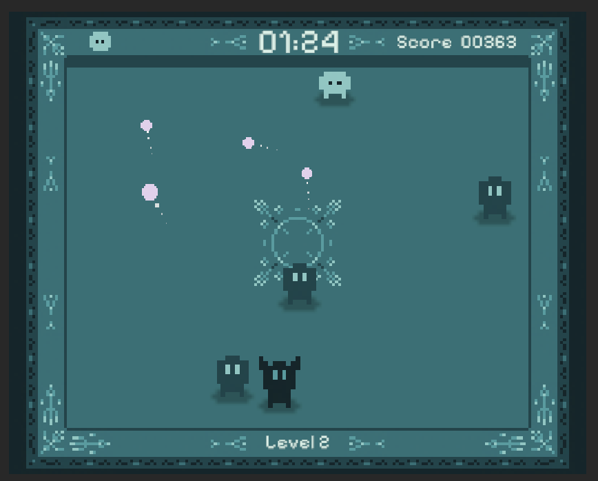
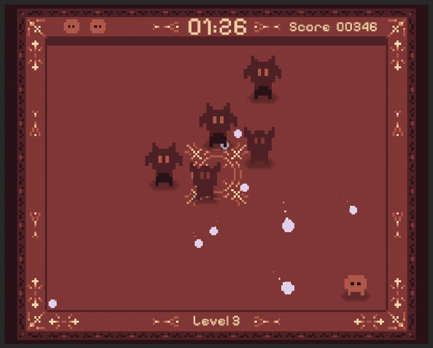
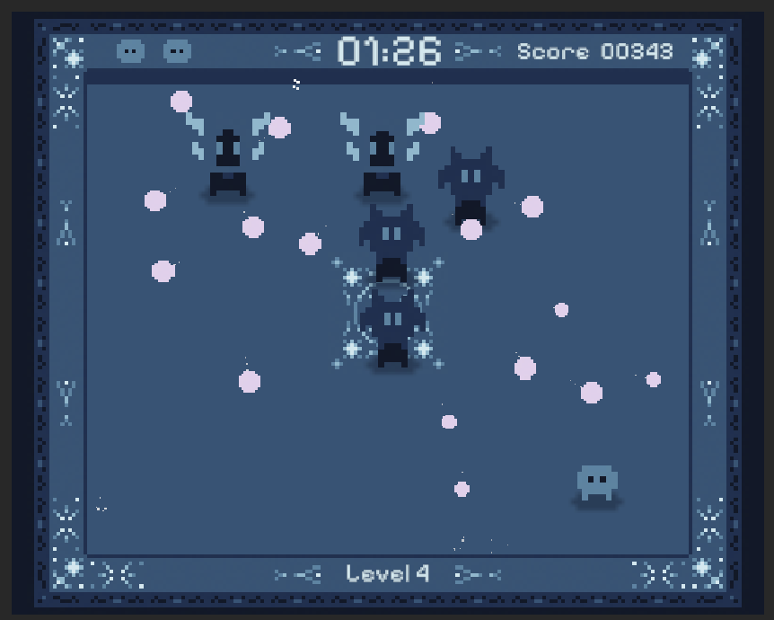

# Got 2 Survive

**Got 2 Survive** is a 2D pixel-art survival game developed with **Unity 6.3** and **C#**. Dodge enemy attacks, stay alive, and earn points for every second you survive across four increasingly challenging levels.

## Gameplay

You start with **3 lives** and must survive **2 minutes per level**. Enemies move around the arena, spawn over time, and fire projectiles with different attack patterns. Getting hit by a projectile or touching an enemy costs one life, followed by a brief period of invulnerability.

The timer resets at the beginning of each level, while your **score and remaining lives carry over**. Survive all four levels to win; lose all three lives and it's game over.

## Screenshots

### Main Menu

### Gameplay

Each stage has a distinct monochromatic palette and introduces new enemy combinations and attack patterns.

| Level 1 — Arcane | Level 2 — Abyssal |
|:---:|:---:|
|  |  |
| **Level 3 — Crimson** | **Level 4 — Frost** |
|  |  |

## Features

- **Four levels**, each with its own monochromatic pixel-art palette.
- **Four enemy types** with distinct projectile patterns, including aimed shots, spread shots, and rotating four-direction bursts.
- **Progressive enemy spawning** with a limit on simultaneous enemies.
- **Survival-based scoring**, rewarding every second you stay alive.
- **Three-life system** with temporary invulnerability after taking damage.
- **Main menu, game-over and victory screens**, with restart and return-to-menu options.
- **Background music and sound effects** for gameplay and menus.

## Controls

| Action | Keys |
| --- | --- |
| Move | **W A S D** or **Arrow Keys** |

## Built With

- **Unity 6.3** — game engine
- **C#** — gameplay and UI scripting
- **Unity 2D Physics** — collisions and trigger detection
- **Unity Input System** — player controls

## Project

This is a small, independently developed game focused on learning and applying core game-development concepts, including enemy AI, projectile patterns, scene transitions, UI management, and audio integration.

> **Repository status:** The Unity project files and a playable build have not yet been added to this repository.
